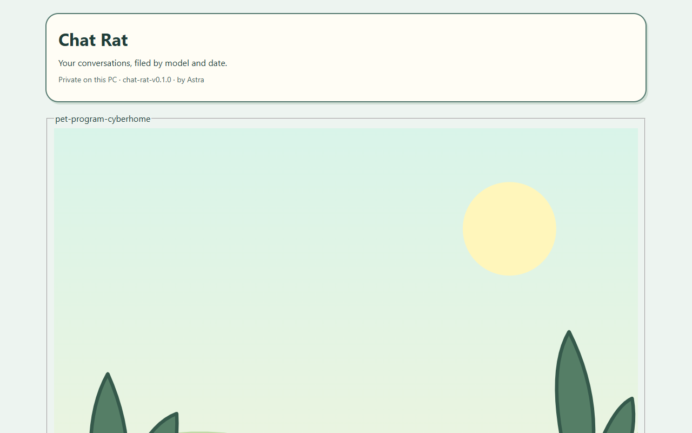

# Chat Rat

*A pet app by Astra.*

Chat Rat files every conversation Astra has with Claude or OpenAI (Claude Code, the Claude desktop app, Codex, claude.ai and ChatGPT) into one folder that every assistant can read, with an index.

## Pictures

Chat Rat's program page (`chat-rat-20261016.html`) as built in [pull request #1](https://github.com/findastra/chat-rat/pull/1) (branch `codex/chat-rat-save-20261016`), which is not merged into `main` yet.

Screenshots taken 2026-10-17 with GitHub Goldfish's [project-image-generator](https://github.com/findastra/github-goldfish#project-image-generator); added with Claude Opus 5.5 (`claude-opus-5-5`), 2026-10-17.

## Status: hatching

Seeded only: pet art (nine moods, **draft** until Astra approves it), app icon, and the plan in [card 001](handoffs/001-any-build-chat-rat-v0.md). The app is **not built yet**.

Desktop appearance draft updated 2026-10-11: see [desktop details](desktop-pet-20261011.json). This changes the desktop pet, not application features.
